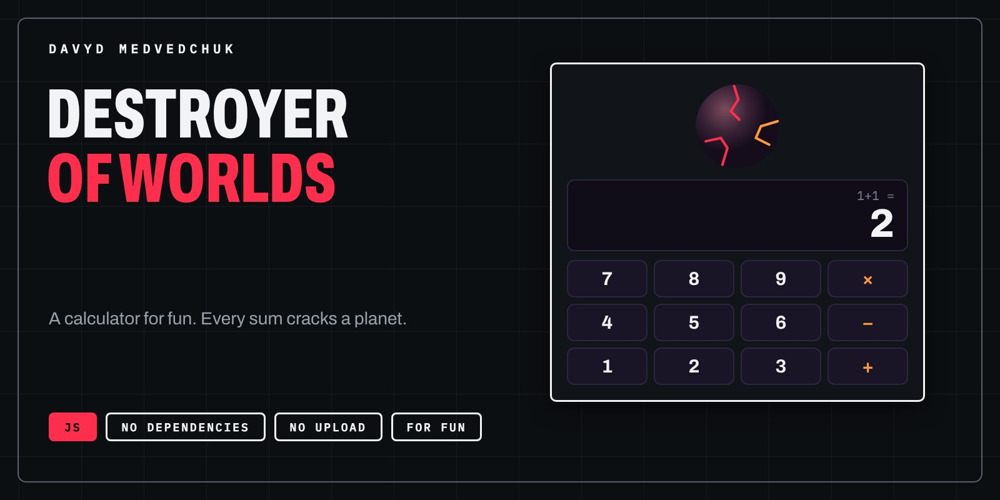

# Destroyer of Worlds



A calculator for fun. A small hooded destroyer in a green terminal glow walks over the keys, every sum cracks the planet above, and the fourth sum ends it. A new planet appears and the counter goes up.

It is a real calculator: `+ − × ÷ %`, decimals, backspace, keyboard input. It follows the usual order of operations, so `2+3×4` is 14.

**Open it:** `index.html`, or the GitHub Pages link of this repo.

## Details

- Nothing leaves your device. No analytics, no cookies, no fonts from other sites. The only thing stored is the count of ended worlds, in your browser.
- The maths is a small parser in [`calc.js`](calc.js), without `eval`. Dividing by zero says so instead of showing "Infinity".
- Sound is a tiny synthesizer and is off until you press the button.
- With "reduce motion" turned on in the system, the shaking and walking animations are switched off.
- Keys: `0-9 + - * / % .`, `Enter` for equals, `Backspace`, `Esc` to clear.

## Tests

```
pip install playwright && playwright install chromium
python tests/test_calc.py
```

Checks the maths, the buttons and keyboard, that the character moves between keys, that a world ends after four sums, that nothing sideways-scrolls at phone width, and that nothing is requested from other sites.

## Limits

- Tested in headless Chromium only. Not tried on a real phone or in Safari or Firefox.
- Percent works as "divide by 100" (`200+10%` is 200.1), not as "10% of 200".
- The planet breaks after four equals, always. Nothing is random about the damage.

MIT. Made by [Davyd Medvedchuk](https://github.com/davydmedvedchuk).
